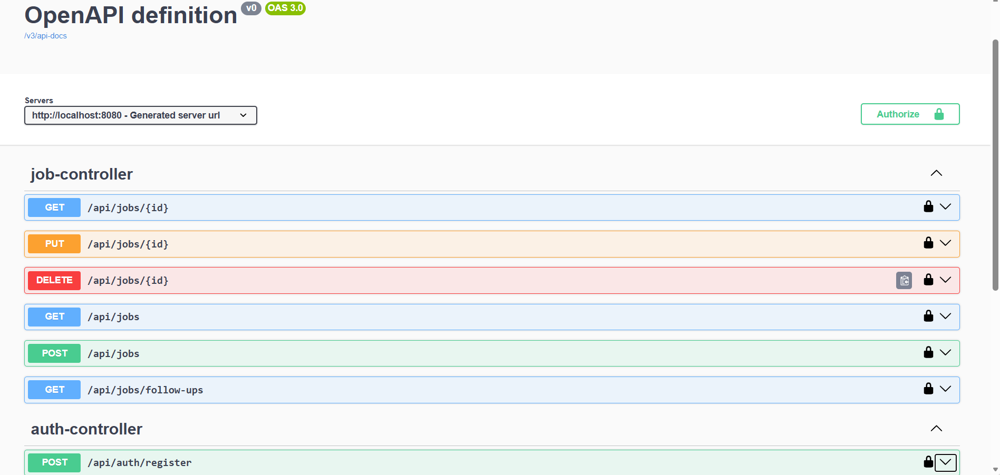
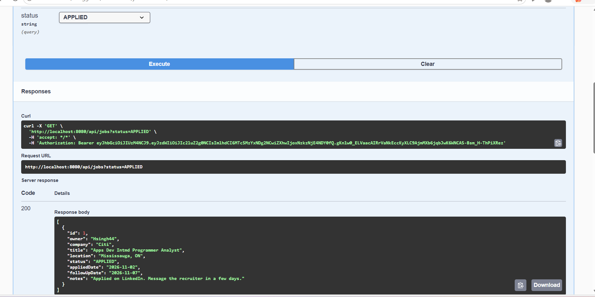
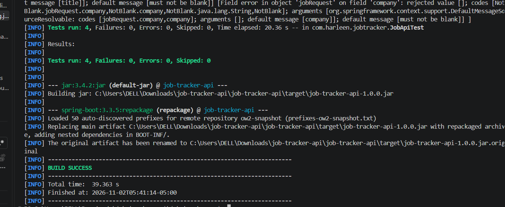

# Job Tracker API

## Screenshots




A secure REST API for tracking job applications, built with Java 17 and Spring Boot 3.

## Features
- JWT authentication (register / login) with BCrypt password hashing
- Full CRUD for job applications, scoped per user (users only see their own data)
- Status tracking: `APPLIED`, `INTERVIEW`, `OFFER`, `REJECTED`, with filtering
- Automatic follow-up date (5 days after applying) and a `/api/jobs/follow-ups` endpoint
- Input validation and proper HTTP status codes
- Interactive API docs (Swagger UI)
- Integration tests (MockMvc), Docker support, GitHub Actions CI, Dependabot alerts

## Tech stack
Java 17, Spring Boot, Spring Security, Spring Data JPA, H2, JJWT, springdoc-openapi, JUnit 5, Maven, Docker, GitHub Actions

## Run locally
```bash
mvn spring-boot:run
```
Open http://localhost:8080/swagger-ui.html

## Run tests
```bash
mvn verify
```

## Run with Docker
```bash
docker build -t job-tracker-api .
docker run -p 8080:8080 -e JWT_SECRET="replace-with-a-long-random-secret-32+chars" job-tracker-api
```

## Endpoints
| Method | Path | Description |
|---|---|---|
| POST | /api/auth/register | Create account, returns JWT |
| POST | /api/auth/login | Login, returns JWT |
| POST | /api/jobs | Add a job application |
| GET | /api/jobs?status=APPLIED | List (optionally filter by status) |
| GET | /api/jobs/follow-ups | Applications due for follow-up |
| GET/PUT/DELETE | /api/jobs/{id} | Read, update, delete one |

Send the token as `Authorization: Bearer <token>`.

## Security notes
Passwords are hashed with BCrypt, the JWT secret is read from the `JWT_SECRET` environment variable, sessions are stateless, and Dependabot monitors dependencies for known vulnerabilities.
